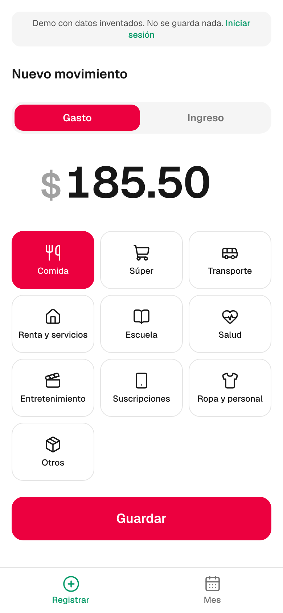
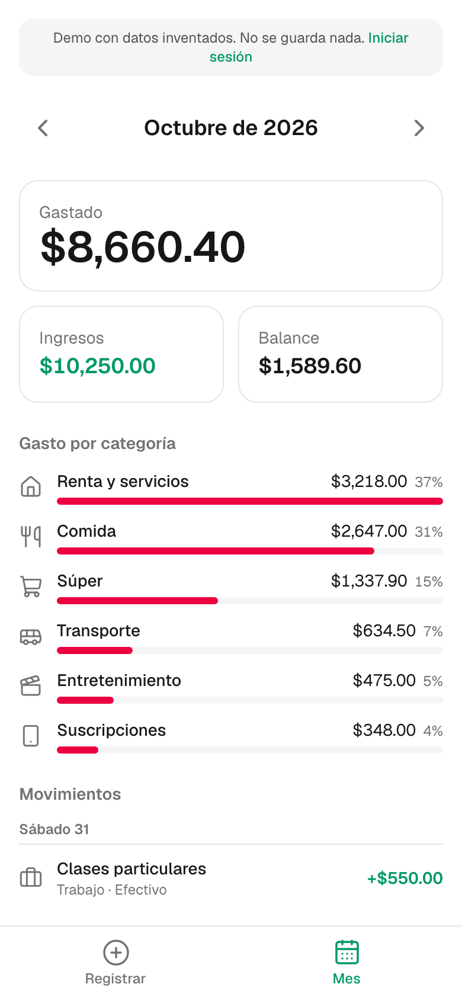
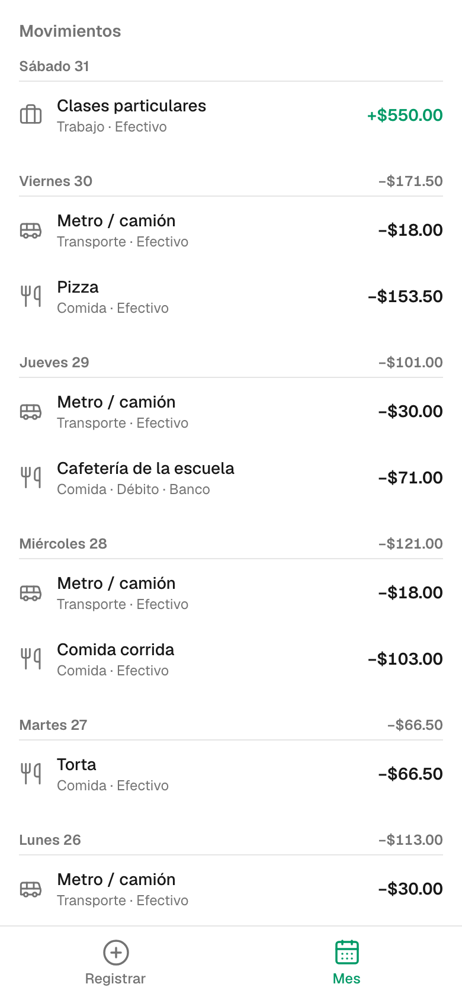
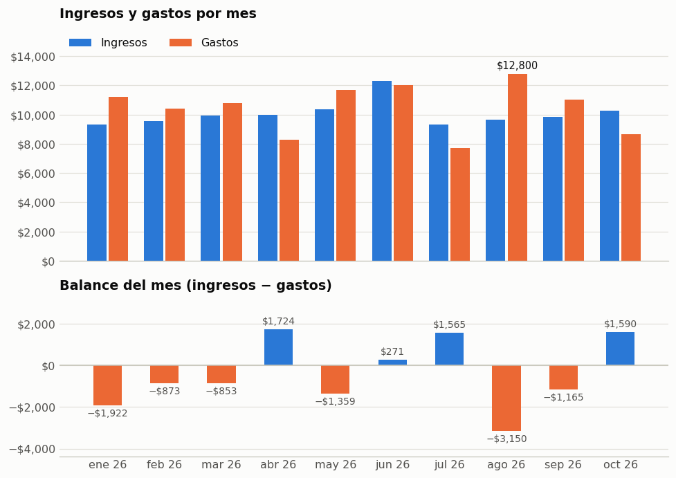
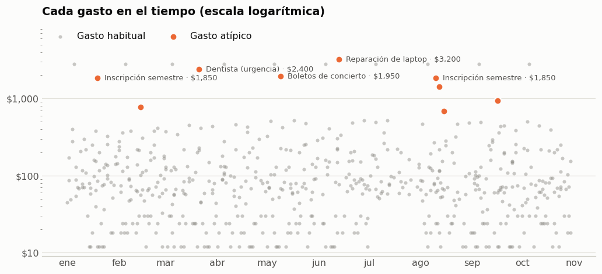
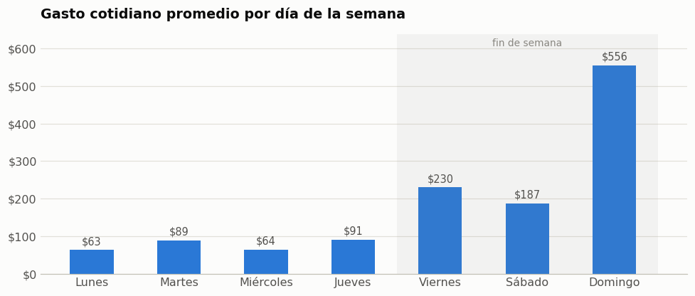
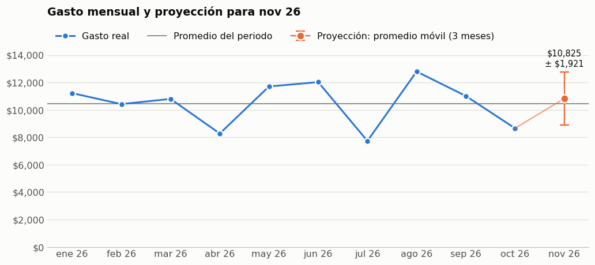

# Finanzas personales

App web para registrar mis gastos desde el celular y un análisis de datos sobre ellos. Es un proyecto personal en dos partes que viven en el mismo repositorio:

1. **App de registro** (Next.js, TypeScript y Supabase): captura rápida de gastos, vista mensual e importación de estados de cuenta del banco.
2. **Análisis de datos** (Python, pandas y Jupyter): limpieza, exploración, detección de gastos recurrentes y atípicos, y una proyección del gasto del próximo mes.

**Demo en vivo, sin cuenta y con datos inventados:** [finanzas-personales-seven-rho.vercel.app/demo](https://finanzas-personales-seven-rho.vercel.app/demo)

<p>
  
  
  
</p>

> Todas las capturas, la demo y los resultados de este README usan **datos inventados**. Mis movimientos reales y mis estados de cuenta nunca se suben al repositorio.

## Por qué lo hice

Soy estudiante, vivo en México y quería saber en qué se me va el dinero. Las apps que probé pedían demasiados pasos para anotar un gasto, así que dejaba de usarlas. Me propuse dos cosas: que **registrar un gasto tome menos de 10 segundos** y que los datos me sirvieran para **practicar minería de datos con un caso real**.

## Qué hace la app

- **Captura rápida.** Monto grande, categorías como botones y un botón Guardar siempre visible. Fecha, descripción y método de pago son opcionales.
- **Vista del mes.** Total gastado, ingresos, balance, gasto por categoría y movimientos agrupados por día, con edición y borrado.
- **Categorías editables.** Se pueden crear, renombrar, cambiar de icono y archivar sin perder el historial.
- **Importar estados de cuenta (PDF y CSV).** Extrae los movimientos, sugiere una categoría, permite revisar antes de guardar y no duplica nada si se importa dos veces el mismo periodo. Cada movimiento indica si se capturó a mano o viene del banco.
- **Ahorro.** Anoto cuánto dinero tengo y qué porcentaje de cada ingreso quiero ahorrar; la app calcula cuánto apartar, cuánto me queda para gastar por día hasta el próximo ingreso y lleva el total ahorrado. Lo apartado no cuenta como gasto.
- **Privada.** Inicio de sesión y seguridad por fila en la base de datos: solo yo veo mis datos.
- **Instalable.** Es una PWA: se añade a la pantalla de inicio del celular y abre a pantalla completa.

### La parte más difícil: leer el PDF del banco

El estado de cuenta de Santander **no contiene texto**: cada página es una imagen. Para extraer los movimientos, la app hace lo siguiente dentro del navegador, sin subir el archivo a ningún servidor:

1. `pdf.js` dibuja cada página en un lienzo.
2. Se blanquean las bandas grises de la tabla, que confunden al reconocimiento de texto.
3. `tesseract.js` reconoce el texto de la imagen (OCR).
4. Un intérprete propio convierte ese texto en movimientos.

El OCR no conserva en qué columna estaba cada monto, así que **depósito o retiro se deduce con aritmética**: si el saldo subió exactamente ese monto fue un depósito; si bajó, un retiro. La misma cadena de saldos permite **detectar y corregir un dígito mal leído**, y al final las sumas se comparan con el renglón TOTAL del propio estado de cuenta. Con un estado de cuenta real de 68 movimientos, las sumas coincidieron al centavo.

## Análisis de datos

El notebook [`analysis/analisis_gastos.ipynb`](analysis/analisis_gastos.ipynb) está escrito como un reporte: cada sección explica qué se hace y por qué, y termina con un hallazgo calculado a partir de los datos. Se puede leer directamente en GitHub.

Hallazgos con los datos de ejemplo (10 meses, 629 movimientos inventados):

| Pregunta | Resultado |
|---|---|
| ¿Cuánto se gasta al mes? | $10,467 en promedio; en 6 de 10 meses el gasto superó al ingreso |
| ¿En qué se concentra? | Renta y servicios, comida y súper suman el 68 % |
| ¿Cambia según el día? | De viernes a domingo se gasta 4.2 veces más por día que de lunes a jueves |
| ¿Qué es fijo? | 4 gastos recurrentes suman $3,348 al mes: el 32 % del gasto |
| ¿Qué es atípico? | 9 gastos (1.5 % de los movimientos) explican el 14 % del gasto total |
| ¿Qué esperar el próximo mes? | $10,825, con un margen de ± $1,921; un mes sin imprevistos cuesta $8,834 |

<p>
  
  
</p>
<p>
  
  
</p>

Técnicas utilizadas:

- **Limpieza:** conversión de tipos, unificación de categorías mal escritas, valores vacíos y duplicados.
- **Gastos recurrentes:** detección por reglas sobre presencia mensual, estabilidad del monto (coeficiente de variación) y del día de cobro.
- **Gastos atípicos:** rango intercuartílico por categoría en escala logarítmica, con un filtro de relevancia. La regla clásica marcaba más del 10 % de los gastos; esta versión deja solo los imprevistos reales.
- **Proyección:** cuatro métodos simples (último mes, promedio histórico, promedio móvil y tendencia lineal) comparados con validación hacia adelante. Con tan pocos datos, un método sencillo y explicable es preferible a uno complejo; el notebook incluye una sección de limitaciones.

## Stack

| Parte | Tecnologías |
|---|---|
| App | Next.js 16 (App Router, Server Actions), React 19, TypeScript, Tailwind CSS 4 |
| Datos y acceso | Supabase: PostgreSQL, autenticación y seguridad por fila (RLS) |
| Importación | pdf.js, tesseract.js (OCR en el navegador), PapaParse |
| Pruebas | Vitest: 43 pruebas sobre la lectura de CSV y PDF, duplicados, categorización y cálculo del ahorro |
| Análisis | Python, pandas, matplotlib, seaborn, Jupyter |
| Despliegue | Vercel |

## Decisiones de diseño

- **Los estados de cuenta no salen del dispositivo.** El PDF o CSV se procesa en el navegador; al servidor solo llegan los movimientos que apruebo en la pantalla de revisión.
- **Seguridad en la base de datos, no solo en la interfaz.** Cada tabla tiene políticas RLS: aunque alguien tuviera la llave pública, no podría leer filas ajenas. El registro de nuevos usuarios está cerrado.
- **Duplicados imposibles por diseño.** Cada renglón importado genera una huella (hash SHA-256 de fecha, monto, tipo, folio y número de repetición) con una restricción `UNIQUE` en la base. Dos compras idénticas el mismo día cuentan como dos, pero reimportar un archivo no duplica nada.
- **Categorías que aprenden.** La sugerencia consulta primero cómo categoricé antes a ese comercio, luego reglas por palabra clave y al final "Otros". No usa servicios externos.
- **Dinero sin errores de redondeo.** Los montos se guardan como `numeric(12,2)` y las sumas se hacen en centavos enteros.
- **Una sola vista para la app y la demo.** Los componentes solo presentan los datos que reciben; por eso la demo pública reutiliza exactamente las mismas pantallas con datos inventados.

## Estructura del repositorio

```
src/app/            Páginas: captura, mes, ahorro, categorías, importar, login y demo
src/components/     Componentes de la interfaz
src/lib/importar/   Lectura de CSV y PDF, huellas y categorización (con pruebas)
src/lib/ahorro/     Cálculo de la meta de ahorro y del dinero disponible (con pruebas)
supabase/           Esquema de la base de datos y políticas de seguridad
analysis/           Notebook, exportador de datos y generador de datos de ejemplo
data/ejemplo/       CSV bancario inventado para probar la importación
data/private/       Estados de cuenta reales (ignorada por git)
docs/capturas/      Imágenes de este README
```

## Cómo correrlo

### App

Requisitos: Node.js 22 y una cuenta gratuita de [Supabase](https://supabase.com).

1. Instalar dependencias:
   ```bash
   npm install
   ```
2. Crear un proyecto en Supabase y ejecutar, en orden, los archivos de `supabase/migrations/` en su SQL Editor.
3. Crear un usuario en **Authentication → Users** y desactivar el registro de nuevos usuarios.
4. Copiar `.env.example` como `.env.local` y poner la URL del proyecto y su llave pública.
5. Iniciar el servidor de desarrollo y abrir `http://localhost:3000`:
   ```bash
   npm run dev
   ```

La demo en `/demo` funciona sin configurar Supabase. Las pruebas se ejecutan con `npm test`.

### Análisis

Requisitos: Python 3.9 o posterior.

```bash
python3 -m venv analysis/.venv
source analysis/.venv/bin/activate
pip install -r analysis/requirements.txt
jupyter notebook analysis/analisis_gastos.ipynb
```

El notebook usa por defecto los datos de ejemplo. Para analizar datos propios, `python3 analysis/exportar_datos.py` descarga los movimientos a `analysis/data/` (carpeta ignorada por git) y basta cambiar `FUENTE = "real"` en la primera celda de código.

## Privacidad

- `data/private/`, `analysis/data/` y los archivos `.env` están en `.gitignore`.
- Las pruebas automáticas usan textos y cifras inventados.
- El exportador inicia sesión como usuario normal; no usa llaves de administrador.

## Siguientes pasos

- Presupuestos por categoría y comparación de lo planeado contra lo real.
- Modelar la estacionalidad (inicio de semestre, vacaciones) cuando haya más meses de datos.
- Soporte para estados de cuenta de otros bancos.

---

Hecho por **María Isabel Ruíz Machorro**.
